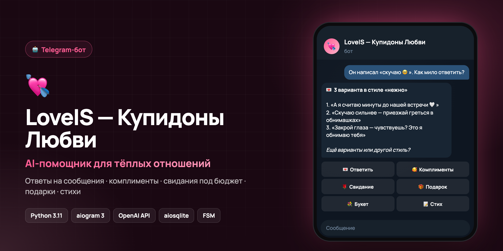

<div align="center">



# LoveIS — Купидоны Любви

**Telegram-бот: AI-помощник для отношений**

   

*🇬🇧 AI relationship helper bot — replies to messages in a chosen style, compliments, budget date plans, DIY gifts, bouquets, poems.*

</div>

---

LoveIS — Telegram-бот, который помогает делать отношения теплее: красиво отвечать на сообщения, придумывать комплименты, стихи, свидания под бюджет, идеи подарков своими руками, букеты, путешествия, парные фото и сценарии любовных видео.

Описание для профиля Telegram:

> LoveIS — твой любовный помощник. Подскажет, как мило ответить любимому человеку, придумает комплименты, стихи, свидание под бюджет, идеи подарков своими руками, путешествие, букет цветов и поможет разобрать сложную ситуацию как живой человек с опытом.

## Возможности

- 💌 3 живых варианта ответа на сообщение в выбранном стиле.
- 🎬 Идеи любовных видео: сторис, поздравление, воспоминания, сюрприз.
- 📸 Идеи парных фото и промты для генерации изображений.
- 🌹 План свидания под бюджет в рублях или тенге.
- ✈️ Примерный расчет путешествия через `TravelProvider` и mock-провайдер.
- 🥰 10 небанальных комплиментов.
- 🧠 Теплый анализ сложной ситуации без токсичных советов.
- 🎁 Безопасные и приятные желания для пары.
- 🧸 DIY-подарки и трендовая идея без парсинга соцсетей.
- 💐 Букет под повод, вкус и бюджет.
- 📝 2 варианта естественного стиха.
- ⚙️ Настройки: смена валюты, сброс диалога, информация о боте.

## Как создать Telegram Bot Token

1. Открой Telegram и найди `@BotFather`.
2. Отправь `/newbot`.
3. Введи имя бота, например `Купидоны Любви`.
4. Введи username, который заканчивается на `bot`.
5. Скопируй токен и положи его в `.env`.

## Как создать .env

Скопируй пример:

```bash
cp .env.example .env
```

Заполни:

```env
BOT_TOKEN=токен_от_BotFather
OPENAI_API_KEY=ключ_OpenAI
OPENAI_MODEL=gpt-4.1-mini
```

`OPENAI_API_KEY` нужен для генерации текстов. Без него бот запустится, но в генеративных разделах попросит добавить ключ.

## Установка зависимостей

Нужен Python 3.11+.

```bash
python3 -m venv .venv
source .venv/bin/activate
pip install -r requirements.txt
```

## Запуск

Из папки `loveis_bot`:

```bash
python -m bot.main
```

## Стартовая картинка

Бот ищет картинку по пути:

```text
assets/start.jpg
```

Если файла нет, `/start` не упадет: бот просто отправит текстовое приветствие и меню выбора валюты.

## Валюта

При первом запуске пользователь выбирает:

- Тенге ₸ — Казахстан
- Рубли ₽ — Россия

Выбор сохраняется в SQLite и используется в свиданиях, цветах, путешествиях и DIY-идеях.

## Путешествия и реальные API билетов

Сейчас используется `MockTravelProvider` в `bot/services/travel_service.py`. Он не парсит сайты и не утверждает, что цены точные. Он делает примерный расчет:

```text
total = tickets + housing_per_night * nights + food_per_day * days + local_transport + entertainment + reserve
```

Для подключения настоящего API:

1. Создай класс, который наследуется от `TravelProvider`.
2. Реализуй методы `search_tickets(...)` и `estimate_trip(...)`.
3. Подключи новый провайдер в `bot/main.py` вместо `MockTravelProvider`.
4. Храни API-ключи в `.env`, не в коде.

Список сайтов для ручной проверки хранится в `bot/config.py`: Aviasales, OneTwoTrip, Tutu, Яндекс Путешествия, Google Travel, Booking, Ostrovok.

## Деплой на VPS

Примерный сценарий:

```bash
sudo apt update
sudo apt install python3.11 python3.11-venv git
git clone <repo-url> loveis_bot
cd loveis_bot
python3.11 -m venv .venv
source .venv/bin/activate
pip install -r requirements.txt
cp .env.example .env
nano .env
python -m bot.main
```

Для постоянной работы можно создать `systemd` service:

```ini
[Unit]
Description=LoveIS Telegram Bot
After=network.target

[Service]
WorkingDirectory=/opt/loveis_bot
ExecStart=/opt/loveis_bot/.venv/bin/python -m bot.main
Restart=always
Environment=PYTHONUNBUFFERED=1

[Install]
WantedBy=multi-user.target
```

## Структура проекта

```text
loveis_bot/
  bot/
    __init__.py
    main.py
    config.py
    database.py
    keyboards.py
    states.py
    handlers/
      __init__.py
      start.py
      menu.py
      sweet_reply.py
      videos.py
      couple_photos.py
      date.py
      travel.py
      compliments.py
      situation.py
      wish.py
      diy.py
      flowers.py
      poems.py
      settings.py
      helpers.py
    services/
      __init__.py
      ai_service.py
      travel_service.py
      budget_service.py
      flower_service.py
      safety_service.py
    repositories/
      __init__.py
      user_repository.py
  assets/
    start.jpg
  .env.example
  requirements.txt
  README.md
```

## База данных

SQLite создается автоматически при запуске.

Таблица `users`:

- `telegram_id`
- `username`
- `first_name`
- `currency`
- `created_at`
- `updated_at`

Таблица `request_history`:

- `id`
- `telegram_id`
- `section`
- `user_input`
- `bot_output`
- `created_at`

